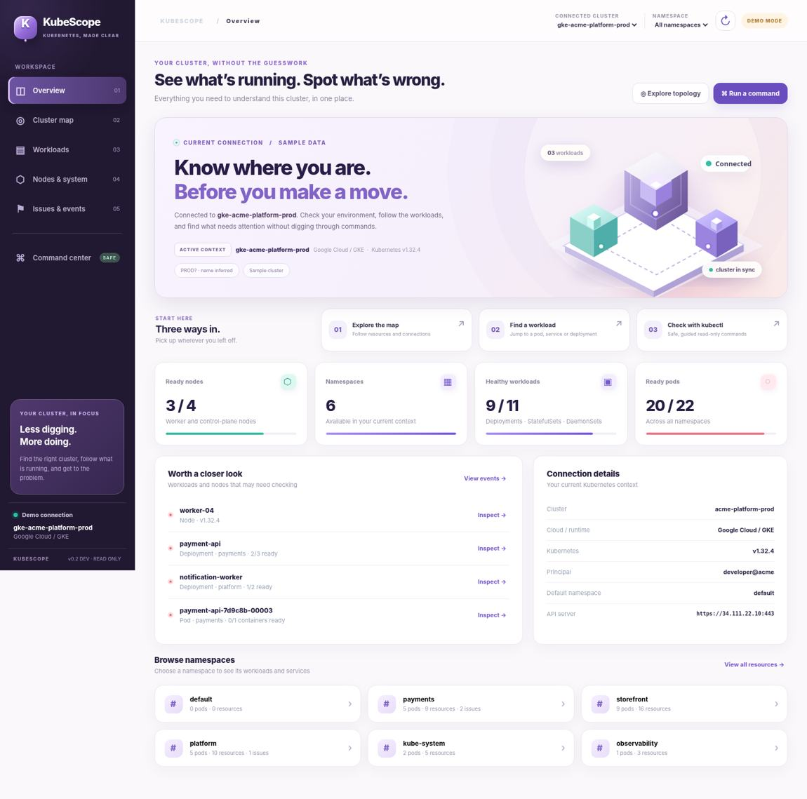

# KubeScope

A local Kubernetes workbench for figuring out which cluster you're in, what's running, and what needs a closer look.



> **Development build — v1.0.0.** This is a read-only prototype for individual developers. It isn't a hosted dashboard or a production-ready multi-user tool.

## Try it without a cluster

From this folder:

```bash
python3 server.py --demo
```

Open http://127.0.0.1:8765. The demo uses sample resources. Nothing connects to Kubernetes.

## Use your own cluster

You'll need Python 3.10+, `kubectl`, a working kubeconfig, and permission to inspect the resources you're interested in. There are no pip, npm, font, or CDN dependencies.

```bash
kubectl config get-contexts
kubectl get nodes
python3 server.py
```

Open http://127.0.0.1:8765, then choose a context from the top-right menu. KubeScope passes the selected context to each command, so it **doesn't change your global kubectl context**.

If port 8765 is taken, use `python3 server.py --port 8989`. Windows users can run `py server.py --demo` or `py server.py`.

## What's inside

- **Overview:** Active context, API endpoint, Kubernetes version, cloud/runtime hints, node and workload health, and namespace shortcuts.
- **Cluster map:** Click through namespaces, workloads, pods, services, and nodes. Some links are inferred from selectors, so they're a starting point, not an authoritative network trace.
- **Workloads:** Filter and inspect Deployments, StatefulSets, DaemonSets, Pods, Services, Ingresses, Jobs, CronJobs, and PVCs.
- **Nodes & system:** Check readiness, role, OS, runtime, kubelet version, and reported capacity.
- **Issues & events:** Find warning events and resources that aren't ready.
- **Command center:** Generate and run approved read-only commands instead of typing them manually. You can inspect resources, view pod logs, check rollout status, and look at metrics when the metrics API is present.

The new UI uses a lightweight, original SVG cluster illustration and CSS. There's no 3D engine to install, and no third-party artwork bundled into the app.

## How commands work

The backend uses `kubectl` with argument arrays, fixed timeouts, and an explicit command allowlist. It doesn't invoke a shell. It won't execute `apply`, `delete`, `patch`, `scale`, `exec`, or other arbitrary commands. The API binds to `127.0.0.1` only, and rejects non-local Host headers and cross-origin command submissions.

That is a useful guardrail, **not** a replacement for Kubernetes RBAC. Use credentials with the minimum permissions you need. Anyone with access to your local browser session can see the resources and logs that your kubeconfig is authorized to read. See [SECURITY.md](SECURITY.md).

## What isn't supported yet

This build does not install into Kubernetes with Helm, run as a shared service, manage multiple users, or provide real-time metric streaming. Large clusters can take longer to load because the backend gathers a bounded snapshot using separate `kubectl` calls. Some resources may not appear if your account lacks permissions. The environment shown from a context name is only a hint, not proof of where you're connected.

The interface and sample workflows were tested in demo mode. Live Kubernetes access still needs testing against real clusters before anyone should rely on it operationally.

## Tests

```bash
python3 -m unittest discover -s tests -v
```

## Branches and development releases

`main` contains just the public project overview and its image. All application code, CI workflows, tests, and detailed developer documentation belong on `dev`. Do not merge `dev` into `main` as part of a release.


Use `dev` for development work. This development pre-release uses the tag `v1.0.0`. It is marked as a pre-release on GitHub, even though the tag does not contain a pre-release suffix. The GitHub workflow publishes **pre-releases**, not stable releases, and checks that a tagged commit belongs to `dev` before publishing.

To publish to a GitHub repository you own, add its URL as the `origin` remote and push the branch and tag:

```bash
git remote add origin git@github.com:yuvaraja402/github-CICD-workflow.git
git push -u origin dev
git push origin v1.0.0
```

Or run `./scripts/publish-dev.sh` after setting `origin`; it checks the branch, tag, clean working tree, and tests before pushing. Neither method is run by the app. See [RELEASE_NOTES.md](RELEASE_NOTES.md) for changes in this build.

## Project files

```text
server.py                       Local API and kubectl integration
static/index.html               App shell
static/app.css                  UI styles
static/app.js                   Views and resource workflows
tests/test_server.py            Backend tests
docs/screenshots/              UI previews (not required at runtime)
.github/workflows/             Development checks and pre-releases
```

## Next up

We're focusing on a smaller install, a smoother way to inspect real clusters, and clearer diagnostics before introducing write operations. A compiled CLI and an optional Helm deployment are future work, not part of this release.
